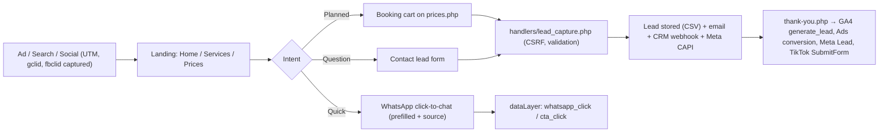

# Sea College Dive Club — Project Blueprint (Phase 1)

> Source of truth for the new website build. Consolidates: owner uploads (Batches 1–4), live web / PADI / Google Business Profile data (Batch 3), Google Ads exports (Batch 2), Google Drive `Media (Source)` inventory (Batch 5) and Competitor Links #1–#4.
> Staging: `https://papayawhip-pheasant-312330.hostingersite.com` (Hostinger Git auto-deploy from `seacollegediveclubsharm-web/sea-college-website`, branch `main` → `public_html`).

---

## 1. Brand Identity, Value Proposition & Competitor Differentiation Matrix

### 1.1 Verified identity
| Field | Value | Source / status |
|---|---|---|
| Legal / brand name | Sea College Dive Club | All sources |
| Recognition | PADI 5 Star Dive Resort + Adopt the Blue conservation center | padi.com profile ✅ |
| Main base | Cyrene Sharm Hotel / Ivy Cyrene Island Aqua Park Resort, Al Montazah, Sharm El Sheikh, South Sinai, Egypt | PADI + GBP + ivy-resorts.com ✅ |
| Other branches | Jaz Dreams & Jaz Fayrouz (Naama Bay) | ⚠️ Unverified — **not published** until owner confirms |
| Rating | 4.9 / 5 from 3,082 Google reviews | GBP ✅ (update number periodically in `site_config.php`) |
| Phone / WhatsApp | +20 100 034 4544 (PADI + GBP) | ✅ used as primary WhatsApp. Alternate numbers (+20 111 456 7886, +20 100 614 5500) held in config |
| Email | info@seacollegediveclub.com | Website + CDWS ✅ |
| Hours | Mon–Sun 08:00–18:00 (PADI) vs “Open 24h” (GBP) | ⚠️ Website shows 08:00–18:00; owner to align GBP |
| Languages spoken | English, Arabic, Russian, German, Italian, French | PADI ✅ |
| Facilities | Training pool, house reef, dive boat, onsite classroom, Nitrox/Trimix, CCR rental, equipment service, A/C, Wi‑Fi | PADI ✅ |
| Social | facebook.com/seacollegediveclub · instagram.com/seacollege.diveclub | ✅ |

### 1.2 Design system (“Red Sea Editorial Field Guide”)
- Palette: Ink Navy `#0B1D2C` · Sea College Teal `#0A84A8` · Salt Sand `#F6F4EF` · White `#FFFFFF` · Coral CTA `#E05A36` · Coral Gold accent `#F28C28`.
- Type: display = system serif stack (Georgia/“Times New Roman”) for editorial headings; UI/body = Inter/system sans; Arabic = “IBM Plex Sans Arabic”/Tahoma fallback, line-height ≥ 1.6.
- Signature elements: sonar-ripple dividers, numbered “Before you book” fact strips, field-notebook labels (📍 location · ⏱ duration · category), rounded cards (20–28px radius), pill chips.

### 1.3 Value proposition
**“Dive the Red Sea with a PADI 5 Star resort right on the beach in Sharm El Sheikh — clear prices, patient multilingual instructors, booked in one WhatsApp message.”**

Proof points: PADI 5 Star · 4.9★ from 3,082 Google reviews · on-site pool + house reef (beginners train before the sea) · own boat to Ras Mohammed, Tiran & Thistlegorm · free hotel transfers in Sharm · 6 languages spoken.

### 1.4 Competitor differentiation matrix
| Capability | Reef Oasis (#1) | Egypt Gate (#2/#3) | Menem Tours (#4) | **Sea College (new site)** |
|---|---|---|---|---|
| Core business | Dive center | Tour marketplace | Tour reseller | **PADI 5★ dive resort + trips** |
| Interactive price list + cart | ✅ 4-step stepper | ❌ | ❌ | ✅ Tabbed price list + booking cart → lead form / WhatsApp |
| Multi-language / currency | Partial | ✅ 10 lang / 4 cur | ✅ 10 lang | ✅ EN + AR (RTL) now; RU/IT/PL/DE roadmap; EUR primary + indicative USD/GBP/EGP |
| Adult / child pricing on cards | ❌ | ❌ | ✅ | ✅ (snorkeling/boat trips) |
| Printable price list | ❌ | ❌ | ✅ | ✅ `Print / Save as PDF` on `/prices.php` |
| Social proof | Low | ✅ multilingual reviews | ✅ Google feed | ✅ 4.9★/3,082 + verified multilingual review cards |
| 1-message WhatsApp booking | ❌ | ✅ | ✅ | ✅ With UTM/campaign source pre-fill |
| On-site pool, house reef, own boat | Partial | ❌ | ❌ | ✅ **Unique advantage** |
| Structured data / AEO | Basic | FAQ | Basic | ✅ Organization + LocalBusiness/DiveShop + Service/Offer + FAQPage + Breadcrumb |

---

## 2. Sitemap, Page Hierarchy & Conversion Funnel Architecture

### 2.1 Sitemap (Phase 2 scope ✅ built · roadmap ⏳)
```
/                         index.php        Home (hero, KPI bar, 8-card explorer, popular, courses, reviews, FAQ, WhatsApp CTA)
/services.php             Services hub     Diving packages · PADI courses · Snorkeling & boats · Offers (anchor sections)
/prices.php               Price list       Reef-Oasis tabbed list + booking cart + printable (Competitor #1 + #4)
/about.php                About us         Story, facilities, PADI 5★, team praise, location map
/contact.php              Contact          Lead form (CSRF + UTM hidden fields), WhatsApp, map, hours
/privacy-policy.php       Privacy & cookies
/terms.php                Terms & conditions (owner docx)
/thank-you.php            Conversion confirmation (fires Lead events)
/sitemap.xml  → sitemap.php (dynamic, hreflang)
/robots.txt
⏳ /courses/<slug>, /trips/<slug>, /dive-sites/, /boats/, /blog/ (AEO articles), RU/IT/PL/DE locales
```

### 2.2 Conversion funnel


Micro-conversions tracked: `cta_click`, `whatsapp_click`, `phone_click`, `email_click`, `outbound_link`, `add_to_cart`, `form_start`, `form_submit`, `newsletter_signup`.

---

## 3. Multilingual Content & Localization Map

| Locale | Status | Direction | Font stack | Notes |
|---|---|---|---|---|
| `en` | ✅ Primary, complete | LTR | Inter / system sans + serif display | Default; `x-default` hreflang |
| `ar` | ✅ UI + key marketing copy | **RTL** | IBM Plex Sans Arabic / Tahoma | ⚠️ Owner/native review before ads point to AR |
| `ru` | ⏳ Roadmap | LTR | — | Draft trip copy in `trips_details.docx`; 3rd biggest Ads language |
| `it`, `pl`, `de` | ⏳ Roadmap | LTR | — | Add file in `/lang/` + register in `SUPPORTED_LANGS` |

**Routing:** `?lang=xx` sets a 1-year `sc_lang` cookie; fallback to `Accept-Language`, then `en`. Every page emits `<html lang dir>` + `hreflang` alternates + `og:locale`.

**RTL rules:** `dir="rtl"` on `<html>`; layout uses CSS logical properties (`margin-inline-start`, `padding-inline`, `inset-inline-end`) so components mirror automatically; directional icons (→) flipped via `[dir=rtl] .flip{transform:scaleX(-1)}`; prices, phone numbers, PADI course names and emails wrapped in `<bdi>`/`dir="ltr"` to stay LTR; no letter-spacing on Arabic text.

**Content keys:** all UI strings in `/lang/{en,ar}.php`; catalog names stay English PADI trademarks with localized descriptions where available (`/data/catalog.php`).

---

## 4. Missing Credentials & Placeholders Checklist

All of these live **only** in `/config/site_config.php` (or environment variables of the same name). Empty value = integration disabled (no script output).

| # | Item | Constant | Status |
|---|---|---|---|
| 1 | Google Tag Manager container | `GTM_ID` | ✅ Live (`GTM-PBVQ56XC`) |
| 2 | GA4 measurement ID | `GA4_ID` | ✅ Live (`G-99528RZN9Z`) |
| 3 | Google Ads conversion ID + labels | `GOOGLE_ADS_ID`, `GOOGLE_ADS_LEAD_LABEL`, `GOOGLE_ADS_WHATSAPP_LABEL`, `GOOGLE_ADS_CALL_LABEL` | ✅ Live (`AW-16728866067` + Lead/WA/Call labels) |
| 4 | Search Console verification token | `GSC_VERIFICATION` | ✅ Live (`MUaOhb7KY5wwxWBDLVgRYIGRxrsU_cW2o36ihx1Kv1k`) |
| 5 | Meta Pixel ID | `META_PIXEL_ID` | ✅ Live (`2622478794929488`, consent-gated) |
| 6 | Meta CAPI access token (+ test code) | `META_CAPI_TOKEN`, `META_CAPI_TEST_CODE` | ❌ Missing — set as env var, never commit |
| 7 | TikTok Pixel ID | `TIKTOK_PIXEL_ID` | ❌ Missing |
| 8 | LinkedIn Insight partner ID | `LINKEDIN_PARTNER_ID` | ❌ Missing (optional — low B2C fit) |
| 9 | Lead notification email + SMTP | `LEAD_NOTIFY_EMAIL`, `SMTP_*` | ⚠️ Defaults to info@…; Hostinger mailbox to confirm |
| 10 | CRM / Sheets / Zapier webhook | `CRM_WEBHOOK_URL` | ✅ Live (Google Sheets CRM & OCT Hub) |
| 11 | Confirmed WhatsApp Business number | `WHATSAPP_NUMBER` | ⚠️ Using +201000344544 (PADI/GBP) — confirm |
| 12 | Branch addresses (Jaz Dreams / Fayrouz) | `LOCATIONS` | ⚠️ Not published until confirmed |
| 13 | Season price validity (sheet says 01-01-2026 → 30-06-2026) | `PRICE_VALIDITY_NOTE` | ⚠️ Expired — owner must confirm current prices |
| 14 | Diving insurance prices (blank in sheet) | catalog | ❌ Shown as “on request” |
| 15 | Payment gateway (online deposit) | — | ⏳ Phase 3+; current flow = request → confirmation on WhatsApp |
| 16 | Production domain switch | `SITE_URL` | ⏳ Staging URL now; change to `https://seacollegediveclub.com` at launch |
| 17 | Arabic copy native review | `/lang/ar.php` | ⚠️ Recommended before AR ads |

**Data conflicts resolved for build** (owner can override): course prices use the newer `Sea_College_Price_List-Updated.xlsx`; courses only in the docx (Rescue €394, EFR €143, Divemaster €850, Adaptive Support €120) use docx prices; the old “Mega” conflict is resolved by the updated sheet (Mega = OWD+AOWD €600, Super = AOWD+Nitrox €400); private boat uses the *One Day Trip* sheet (€550/€650/€900/€1,100).
